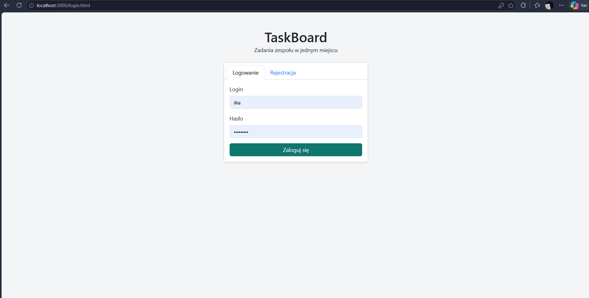
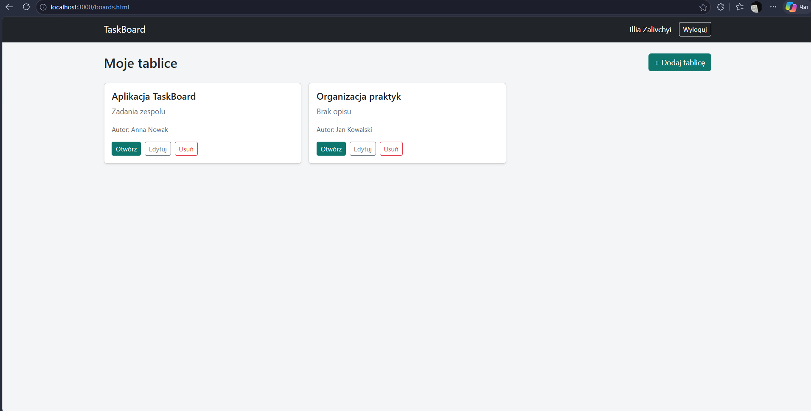
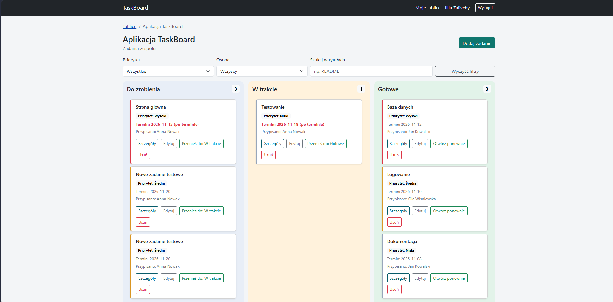

# TaskBoard

TaskBoard to aplikacja internetowa służąca do zarządzania zadaniami.
Umożliwia rejestrację, logowanie, tworzenie tablic oraz dodawanie,
edytowanie, filtrowanie i usuwanie zadań.

## Technologie

- **Frontend:** HTML, CSS, JavaScript, Bootstrap 5
- **Backend:** Node.js, Express
- **Baza danych:** MySQL
- **Narzędzia:** Visual Studio Code, Git, GitHub, XAMPP

## Wymagane środowisko

- Windows 11
- Node.js i npm
- Git
- XAMPP (MySQL lub MariaDB, phpMyAdmin)
- Przeglądarka internetowa

## Uruchomienie

### 1. Pobranie projektu

Sklonuj repozytorium:

```bash
git clone https://github.com/wholeucb/taskboard-illia-zalivchyi.git
cd taskboard-illia-zalivchyi
```

### 2. Przygotowanie bazy danych

1. Uruchom MySQL w panelu XAMPP.
2. Otwórz phpMyAdmin.
3. Zaimportuj plik `database/taskboard.sql`.
4. Następnie zaimportuj `database/konta.sql`.
5. Przed importem `konta.sql` ustaw własne hasła kont bazy.

Plik `taskboard.sql` tworzy bazę `taskboard` i potrzebne tabele.

Plik `konta.sql` tworzy konta:

- `taskboard_app` – odczyt, dodawanie i edycja danych.
- `taskboard_admin` – pełne uprawnienia.
- `taskboard_report` – tylko odczyt.

### 3. Konfiguracja środowiska

W głównym folderze projektu utwórz plik `.env`:

```dotenv
DB_HOST=localhost
DB_USER=taskboard_app
DB_PASSWORD=TU_WPISZ_HASLO
DB_NAME=taskboard
SESSION_SECRET=TU_WPISZ_DLUGI_LOSOWY_SEKRET
```

Hasło `DB_PASSWORD` musi być zgodne z hasłem konta
`taskboard_app` utworzonego w MySQL.

Plik `.env` zawiera poufne dane i nie powinien być
dodawany do repozytorium GitHub.

### 4. Instalacja zależności

Otwórz terminal w głównym folderze projektu:

```bash
cd backend
npm install
```

### 5. Uruchomienie serwera

W folderze `backend` wykonaj:

```bash
npm start
```

Serwer uruchamia się pod adresem:

`http://localhost:3000`

### 6. Uruchomienie aplikacji

Otwórz w przeglądarce:

`http://localhost:3000/login.html`

Zarejestruj nowe konto lub zaloguj się na istniejące.

## Funkcje aplikacji

- Rejestracja i logowanie użytkowników.
- Tworzenie, edytowanie i usuwanie tablic.
- Dodawanie, edytowanie i usuwanie zadań.
- Zmiana statusu i priorytetu zadania.
- Przypisywanie zadań użytkownikom.
- Filtrowanie zadań według priorytetu i osoby.
- Wyszukiwanie zadań po tytule.
- Walidacja formularzy i komunikaty błędów.
- Responsywny interfejs na telefonach.

## Konta testowe

Po uruchomieniu aplikacji można utworzyć konto testowe
przez formularz rejestracji.

Przykładowe dane do rejestracji:

- Login: `tester`
- Imię: `Jan`
- Nazwisko: `Testowy`
- Hasło: wybrane hasło o długości co najmniej 8 znaków

Jeżeli login jest zajęty, należy wybrać inny.

## Struktura projektu

| Folder lub plik | Opis |
| --- | --- |
| `frontend/` | Interfejs HTML, CSS i JavaScript |
| `backend/` | Serwer Express i obsługa API |
| `backend/routes/` | Trasy API |
| `database/` | Skrypty SQL i kopia zapasowa |
| `docs/` | Dokumentacja i raport testów |
| `docs/zadania/` | Opisy realizowanych zadań |
| `.env` | Lokalna konfiguracja środowiska |

## Baza danych

Aplikacja korzysta z trzech głównych tabel:

- `users` – dane użytkowników.
- `boards` – tablice użytkowników.
- `tasks` – zadania przypisane do tablic.

Jeden użytkownik może tworzyć wiele tablic.
Jedna tablica może zawierać wiele zadań.
Zadanie może być przypisane do użytkownika.

### Soft delete

Usunięcie tablicy lub zadania ustawia `isDeleted = 1`.
Rekord pozostaje w bazie danych, ale nie jest wyświetlany
na liście aktywnych elementów.

### Kopia zapasowa

Kopia zapasowa znajduje się w folderze `database/backup/`.

Poprawność kopii sprawdzono wcześniej przez odtworzenie
bazy `taskboard_test`.

## Dokumentacja

- [Dokumentacja API](docs/api.md)
- [Raport testów](docs/testy.md)
- [Opis danych](docs/dane.md)
- [Zadanie TB-3](docs/zadania/TB-3.md)

## Testowanie i dostępność

Aplikacja została sprawdzona na komputerze i w widoku mobilnym.

- Filtrowanie zadań działa z kilkoma parametrami jednocześnie.
- Formularze wyświetlają komunikaty walidacji.
- Lighthouse Accessibility: 100/100 na trzech stronach.
- W3C HTML Validator: brak błędów na trzech stronach.

Szczegóły testów znajdują się w `docs/testy.md`.

## Zrzuty ekranu

### Logowanie



### Lista tablic



### Zadania i filtry



## Autor

Illia Zalivchyi, 3TP
