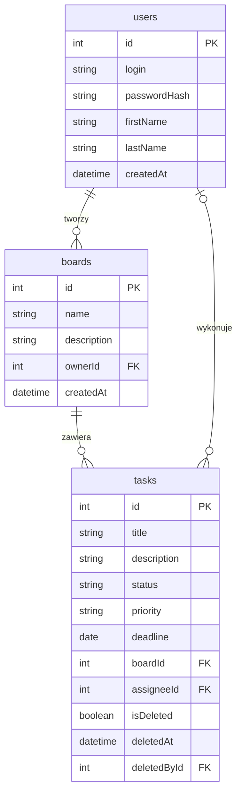

# Opis danych TaskBoard

## Co aplikacja przechowuje

### Użytkownik

| Informacja | Przykład |
| --- | --- |
| Imię (`firstName`) | Jan |
| Nazwisko (`lastName`) | Kowalski |
| Login (`login`) | janek |
| Hasło (`passwordHash`) | Zaszyfrowane hasło |
| Data utworzenia (`createdAt`) | 2026-11-04 |

### Tablica

| Informacja | Przykład |
| --- | --- |
| Nazwa (`name`) | Moje zadania |
| Opis (`description`) | Zadania do wykonania |
| Data utworzenia (`createdAt`) | 2026-11-04 |
| Autor (`ownerId`) | 1 |

### Zadanie

| Informacja | Przykład |
| --- | --- |
| Tytuł (`title`) | Nauka HTML |
| Opis (`description`) | Powtórzyć podstawy HTML |
| Status (`status`) | in_progress |
| Priorytet (`priority`) | high |
| Termin (`deadline`) | 2026-11-10 |
| Tablica (`boardId`) | 1 |
| Przypisana osoba (`assigneeId`) | 1 |

## Powiązania

Jeden użytkownik może mieć kilka tablic. Na jednej tablicy może znajdować się wiele zadań. Każde zadanie jest przypisane do jednej tablicy. Do zadania można przypisać użytkownika, który będzie je wykonywać.

## Przykład zadania w JSON

```json
{
  "id": 1,
  "title": "Nauka HTML",
  "description": "Powtórzyć podstawy HTML",
  "status": "in_progress",
  "priority": "high",
  "deadline": "2026-11-10",
  "boardId": 1,
  "assigneeId": 1
}
```

## Wstępny diagram ERD

Diagram pokazuje tabele bazy danych i ich powiązania.


