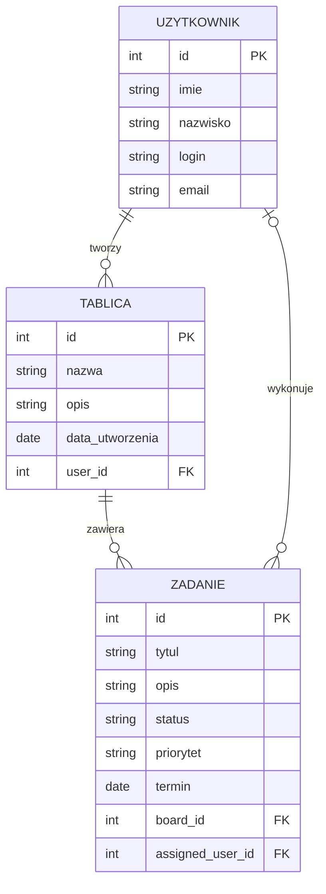

# Opis danych TaskBoard

## Co aplikacja przechowuje

### Użytkownik

| Informacja | Przykład |
| --- | --- |
| Imię | Jan |
| Nazwisko | Kowalski |
| Login | janek |
| E-mail | jan@gmail.com |

### Tablica

| Informacja | Przykład |
| --- | --- |
| Nazwa tablicy | Moje zadania |
| Opis | Zadania do wykonania |
| Data utworzenia | 2026-11-04 |
| Autor | Jan Kowalski |

### Zadanie

| Informacja | Przykład |
| --- | --- |
| Tytuł | Nauka HTML |
| Opis | Powtórzyć podstawy HTML |
| Status | W trakcie |
| Priorytet | Wysoki |
| Termin | 2026-11-10 |

## Powiązania

Jeden użytkownik może mieć kilka tablic. Na jednej tablicy może znajdować się wiele zadań. Każde zadanie jest przypisane do jednej tablicy. Do zadania można przypisać osobę, która będzie je wykonywać.

## Przykład zadania w JSON

```json
{
  "id": 1,
  "title": "Nauka HTML",
  "description": "Powtórzyć podstawy HTML",
  "status": "W trakcie",
  "priority": "Wysoki",
  "dueDate": "2026-11-10",
  "boardId": 1,
  "assignedUserId": 1
}
```

## Wstępny diagram ERD

Diagram pokazuje, jakie informacje są przechowywane w aplikacji i jak są ze sobą połączone.


