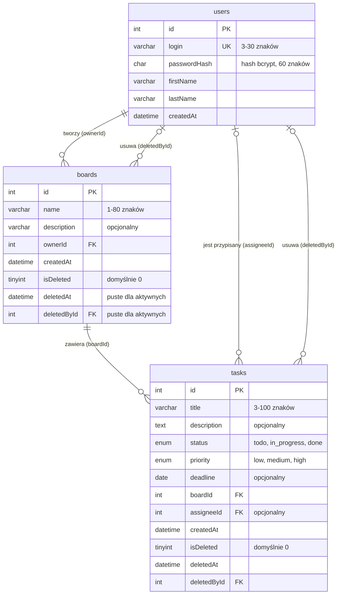

# Diagram ERD bazy TaskBoard

Struktura obowiązuje wszystkich w projekcie. Pola są w camelCase, nazwy tabel małymi literami. Diagram wyświetla się na GitHubie (Mermaid).

**Soft delete:** usunięcie ustawia naraz `isDeleted = 1`, `deletedAt` i `deletedById`; aplikacja pokazuje tylko rekordy z `isDeleted = 0`.
